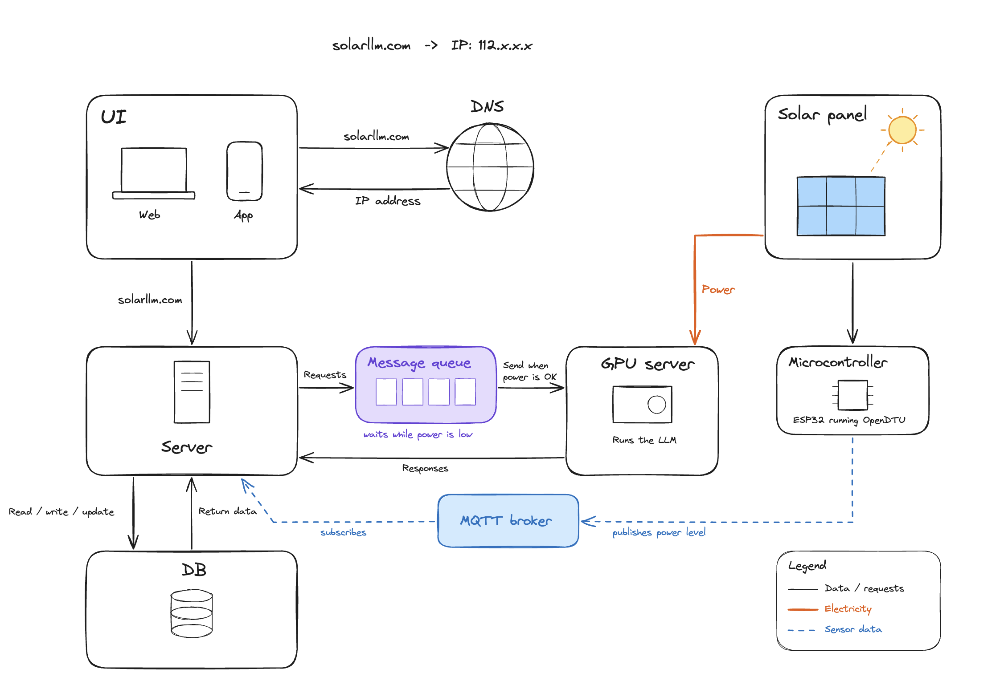
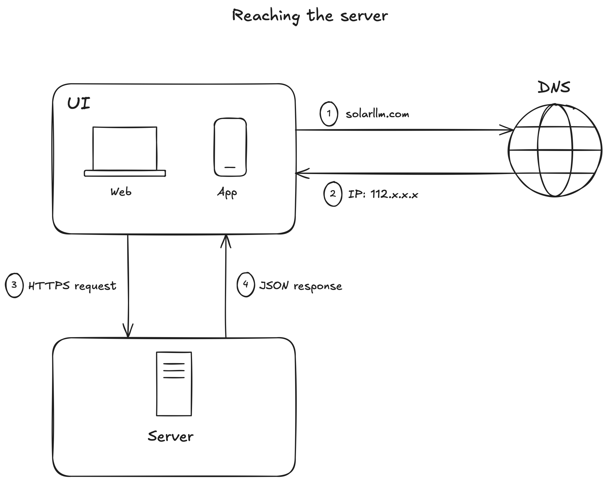
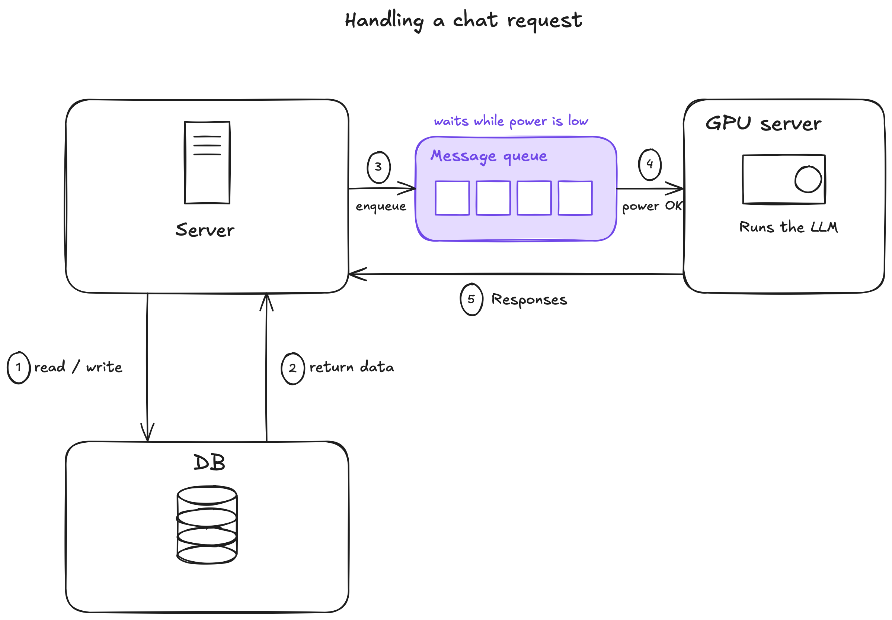
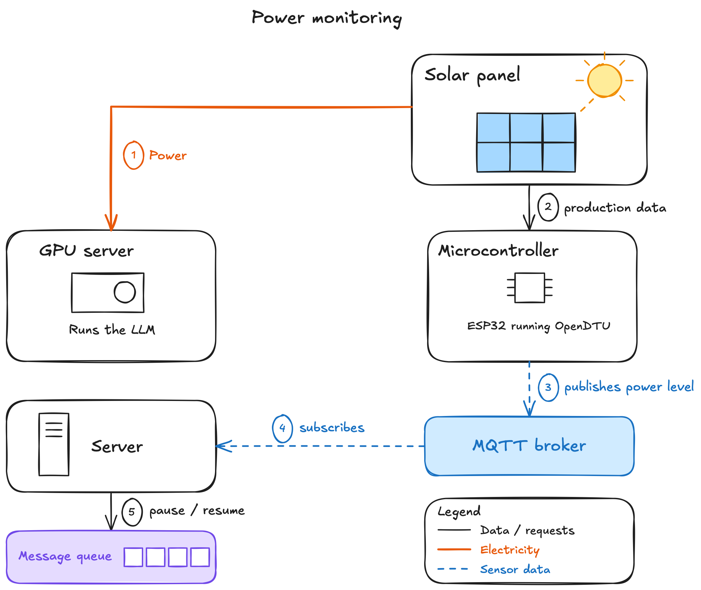

# Solar LLM

## Contents

- [Architecture](#architecture)
- [Our Summary structure (max. 1,000 words) [Remove after]](#our-summary-structure-max-1000-words-remove-after)
  - [Description](#description)
  - [Components](#components)
  - [Communication Flow](#communication-flow)
    - [1. Reaching the server](#1-reaching-the-server)
    - [2. Handling a chat request](#2-handling-a-chat-request)
    - [3. Power monitoring](#3-power-monitoring)
  - [Energy Supply](#energy-supply)

---

## Architecture

---

## Our Summary structure (max. 1,000 words) [Remove after]

### Description
SolarLLM is a small student project: a free chatbot for students at CODE University. It runs open-weights models (for example Llama, Mistral, or Qwen) on our own GPU server, so there are no API costs. The server is powered by the solar panel on campus, which means it is not always available and will not be as fast as commercial services. When there isn't enough power, requests wait in a queue until there is. We want to find out how far a setup like this can go, and whether it can offer students cheaper and more accessible AI.

### Components

| Component | Description |
| --- | --- |
| **UI** | Users can access the service from web browsers and mobile apps. |
| **DNS** | DNS translates human-friendly domain names (like solarllm.com) into IP addresses. |
| **Server** | The server handles requests from users, while reading, writing, and updating the database. It sends requests to the queue, receives responses from the GPU server, and subscribes to solar status data from the broker to decide when queued requests are released. |
| **Database** | Stores user data such as IP addresses, emails, names, conversations, etc. |
| **Message queue** | Every user request (message to the LLM) is added to the queue when it is created. Requests are only sent to the GPU server when solar power is sufficient. |
| **GPU server** | Uses open-weight LLMs to avoid API costs. ⚠️ **To discuss:** whether users can choose between different models in the UI. Every extra loaded model uses GPU memory that would otherwise hold conversations (KV cache), so fewer users can be served at the same time. |
| **Solar panel** | Mounted on the roof of the Delta campus. Generates the renewable electricity that powers the GPU server. |
| **Microcontroller (OpenDTU)** | Collects status data from the solar inverter (e.g. current power in W and energy generated in kWh) and publishes it to the MQTT broker. |
| **MQTT broker** | Receives solar status data published by the microcontroller and forwards it to the server, which subscribes to it. |

### Communication Flow

> *How data moves through the system*
>
> *How the queue holds requests when power is low and releases them when power is good enough.*

_TODO: short intro explaining that the system has three flows and how they relate to each other._

#### 1. Reaching the server

_TODO: what this flow covers._

1. **solarllm.com** — _TODO_
2. **IP: 112.x.x.x** — _TODO_
3. **HTTPS request** — _TODO_
4. **JSON response** — _TODO_

#### 2. Handling a chat request

_TODO: what this flow covers._

1. **read / write** — _TODO_
2. **return data** — _TODO_
3. **enqueue** — _TODO_
4. **power OK** — _TODO_
5. **Responses** — _TODO_

#### 3. Power monitoring

_TODO: what this flow covers._

1. **Power** — _TODO_
2. **production data** — _TODO_
3. **publishes power level** — _TODO_
4. **subscribes** — _TODO_
5. **pause / resume** — _TODO_

### Energy Supply

> *How the solar panel powers the GPU server, and what happens when there isn’t enough sun.*

- The GPU server relies directly on the power generated by the solar panel and operates only when sufficient power is available.
- During periods of insufficient sunlight (nights or weather conditions):
  - **Low power priority:** when there isn't enough sunlight to power the GPU server, the backend server can still accept student prompts and queue them.
  - **Dynamic model switching:** during low sun exposure the orchestrator can route prompts to smaller LLMs.
  - **Grid Fallback or energy storage:** In case of no sun exposure power could be also sourced from the energy grid or during peak sun hours the energy can be stored in a battery on campus.
